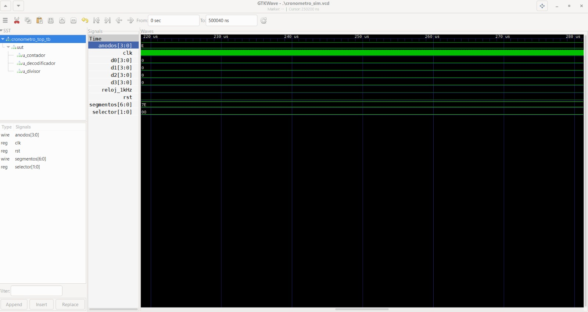

# LABORATORIO 04: CRONOMETRO MULTIPLEXADO  

## Integrantes
* [Wilmer Fernando Puentes Gomez](https://github.com/wilmerfepuentesgo-alt)
* [Jhojan Manuel Castro Mendoza](https://github.com/casjho05)
* [Alberto Rodriguez Medina](https://github.com/22561132!)
  
## INFORME

Indice:

1. [Documentación]
2. [Simulaciones]
3. [Evidencias]
4. [Conclusiones]
5. [Referencias]

### 1. DOCUMENTACION:

#### OBJETIVO:
Implementar un cronómetro digital capaz de contar segundos, décimas, centésimas y milésimas de segundo, visualizando el resultado en el display de 7 segmentos integrado en la FPGA.

#### MARCO TEÓRICO:

##### Lógica Secuencial: 

La lógica secuencial es una rama de la electrónica digital que estudia sistemas cuyo comportamiento depende no solo de las entradas actuales, sino también del historial de estados anteriores. A diferencia de la lógica combinacional —donde la salida es función exclusiva de las entradas presentes— en los sistemas secuenciales la salida evoluciona según la secuencia de eventos pasados, lo que les permite recordar información.

### COMPONENTES Y PRINCIPIOS FUNDAMENTALES:

##### Flip-Flops: 

Los flip-flops son los elementos de memoria básicos de la lógica secuencial. Cada uno almacena un bit de información y mantiene su estado hasta recibir una señal de activación proveniente del reloj del sistema. Los tipos más utilizados son:

Tipo D – Captura el valor de la entrada en el flanco activo del reloj.
Tipo T – Conmuta su estado cada vez que la entrada está activa.
Tipo SR – Permite Set y Reset independientes de su salida.
Tipo JK – Generalización del SR que elimina el estado prohibido.

Este es un tipo de Flip Flop con Set y Reset y un Reloj o contador de pulsos. 

##### Registros
Un registro es un conjunto de flip-flops que opera de forma coordinada para almacenar múltiples bits de información. Los registros de desplazamiento, en particular, permiten mover datos entre flip-flops adyacentes con cada pulso de reloj, siendo una operación fundamental en muchos sistemas digitales.

##### Contadores
Los contadores son circuitos construidos a partir de flip-flops encadenados, diseñados para llevar la cuenta de pulsos de reloj. Según su configuración, pueden contar en secuencia binaria, BCD, Gray u otras codificaciones.

### SIMULACIONES: 

A continuacion se mostraran los resultados de la sintetizacion en Verilog de las siguientes simulaciones: 
- Divisor de Frecuencia 
- Cronometro (Archivo Test Bench)
- Contador de 4 Bits 
- Decodificador Multiplexor

#### DIVISOR DE FRECUENCIA: 

En esta imagen observamos el espectro de Frecuencia programado en 1KHz la señal de Reset y el Reloj el cual esta programado en 1KHz

#### CRONOMETRO: 

En esta imagen se muestra la entrada del multiplexor con sus cuatro entradas D0, D1, D2 y D3 representando la maxima cantidad de bits para este cronometro representado en cada Display 7 Segmentos. 

#### CONTADOR DE 4 BITS: 

En esta imagen se muestra el diagrama sintetizado en Verilog, en el cual se observa el conteo de cada digito [0:3] en cada uno de los Display 7 Segmentos y en el cual tambien se incluye el selector y el boton o el reset incluido para el reloj de 50MHz. 

#### DECODIFICADOR MULTIPLEXOR: 

En esta imagen se muestra la sintetizacion de todas las partes conjuntas en el multiplexor indicado en la imagen anterior, en ella se observa el comportamiento de cada digito en cada display 7 segmentos. Adicionalmente se incluye tambien el selector y el reset para que reinicie el conteo una vez se llega al desborde de la señal del flanco de subida del reloj 50MHz. 

### EVIDENCIAS: 

#### CODIGO IMPLEMENTADO EN VERILOG: 
 
// SOLUCIÓN DE LABORATORIO: SISTEMA CRONÓMETRO MULTIPLEXADO SEPARADO
// 
module cronometro_top (
    input wire clk_50MHz,    // Entrada de reloj base (Asegurar PIN_64 o PIN_14)
    input wire rst_n,        // Botón de reset (Activo en BAJO)
    input wire [1:0] modo,   // Switches de selección de velocidad
    
    // Pines de control para los 4 dígitos (Cátodo Común)
    output reg dig_1, // Izquierda
    output reg dig_2,
    output reg dig_3,
    output reg dig_4, // Derecha
    
    // Pines independientes para cada segmento físico
    output reg seg_A, output reg seg_B, output reg seg_C,
    output reg seg_D, output reg seg_E, output reg seg_F, output reg seg_G
);

    // --- RELOJES INTERNOS CALIBRADOS ---
    reg [31:0] cont_ms;      // Divisor principal de 32-bits para máxima estabilidad
    reg clk_ms;              // Reloj base de 1 ms (1000 Hz)
    reg clk_conteo;          // Reloj seleccionado por el multiplexor de modo

    // Contadores de tiempo secundarios basados en flancos limpios
    reg [3:0] cont_cen, cont_dec, cont_seg;
    reg clk_cen, clk_dec, clk_seg;

    // Registros BCD de almacenamiento para los 4 dígitos del cronómetro
    reg [3:0] bcd0, bcd1, bcd2, bcd3; 

    // Buses de interconexión para los decodificadores de 7 segmentos
    wire [6:0] disp0, disp1, disp2, disp3;
    reg [1:0] selector_barrido;

    // ====================================================================
    // DIVISOR DE RELOJ PRINCIPAL (Estabilización de Frecuencia)
    // ====================================================================
    // Ajustado a 50 MHz. Si tu placa usa 24 MHz, cambia el valor a 24000.
    always @(posedge clk_50MHz or negedge rst_n) begin
        if (!rst_n) begin
            cont_ms <= 31'd0;
            clk_ms  <= 1'b0;
        end else begin
            if (cont_ms == 31'd49999) begin
                cont_ms <= 31'd0;
                clk_ms  <= ~clk_ms; // Pulso síncrono constante de 1ms
            end else begin
                cont_ms <= cont_ms + 1'b1;
            end
        end
    end

    // ====================================================================
    // DIVISORES DE TIEMPO SECUNDARIOS (BASADOS EN FLANCOS DE RELOJ)
    // ====================================================================
    always @(posedge clk_ms or negedge rst_n) begin
        if (!rst_n) begin cont_cen <= 4'd0; clk_cen <= 1'b0; end
        else if (cont_cen == 4'd9) begin cont_cen <= 4'd0; clk_cen <= ~clk_cen; end
        else begin cont_cen <= cont_cen + 1'b1; end
    end

    always @(posedge clk_cen or negedge rst_n) begin
        if (!rst_n) begin cont_dec <= 4'd0; clk_dec <= 1'b0; end
        else if (cont_dec == 4'd9) begin cont_dec <= 4'd0; clk_dec <= ~clk_dec; end
        else begin cont_dec <= cont_dec + 1'b1; end
    end

    always @(posedge clk_dec or negedge rst_n) begin
        if (!rst_n) begin cont_seg <= 4'd0; clk_seg <= 1'b0; end
        else if (cont_seg == 4'd9) begin cont_seg <= 4'd0; clk_seg <= ~clk_seg; end
        else begin cont_seg <= cont_seg + 1'b1; end
    end

    // Multiplexor de velocidad del cronómetro (Escalas de tiempo)
    always @(*) begin
        case (modo)
            2'b00: clk_conteo = clk_ms;   // Milésimas
            2'b01: clk_conteo = clk_cen;  // Centésimas
            2'b10: clk_conteo = clk_dec;  // Décimas
            2'b11: clk_conteo = clk_seg;  // Segundos
            default: clk_conteo = clk_ms;
        endcase
    end

    // ====================================================================
    // CONTADORES DEL CRONÓMETRO BCD EN CASCADA (0000 - 9999)
    // ====================================================================
    always @(posedge clk_conteo or negedge rst_n) begin
        if (!rst_n) begin
            bcd0 <= 4'd0; bcd1 <= 4'd0; bcd2 <= 4'd0; bcd3 <= 4'd0;
        end else begin
            if (bcd0 == 4'd9) begin
                bcd0 <= 4'd0;
                if (bcd1 == 4'd9) begin
                    bcd1 <= 4'd0;
                    if (bcd2 == 4'd9) begin
                        bcd2 <= 4'd0;
                        if (bcd3 == 4'd9) begin
                            bcd3 <= 4'd0;
                        end else begin
                            bcd3 <= bcd3 + 1'b1;
                        end
                    end else begin
                        bcd2 <= bcd2 + 1'b1;
                    end
                end else begin
                    bcd1 <= bcd1 + 1'b1;
                end
            end else begin
                bcd0 <= bcd0 + 1'b1;
            end
        end
    end

    // Contandor para el barrido del multiplexor (Frecuencia constante de refresco)
    always @(posedge clk_ms or negedge rst_n) begin
        if (!rst_n) selector_barrido <= 2'b00;
        else        selector_barrido <= selector_barrido + 1'b1;
    end

    // Instancia de los bloques decodificadores auxiliares
    decoh7seg dec0 (bcd0, disp0);
    decoh7seg dec1 (bcd1, disp1);
    decoh7seg dec2 (bcd2, disp2);
    decoh7seg dec3 (bcd3, disp3);

    // ====================================================================
    // MULTIPLEXOR CORRECTO: ASIGNACIÓN DE BITS SEPARADOS PIN POR PIN
    // ====================================================================
    reg [6:0] seg_bus;
    always @(*) begin
        case (selector_barrido)
            2'b00: begin
                dig_1 = 1'b1; dig_2 = 1'b1; dig_3 = 1'b1; dig_4 = 1'b0; // Activa Dígito 4 (Der)
                seg_bus = disp0;
            end
            2'b01: begin
                dig_1 = 1'b1; dig_2 = 1'b1; dig_3 = 1'b0; dig_4 = 1'b1; // Activa Dígito 3
                seg_bus = disp1;
            end
            2'b10: begin
                dig_1 = 1'b1; dig_2 = 1'b0; dig_3 = 1'b1; dig_4 = 1'b1; // Activa Dígito 2
                seg_bus = disp2;
            end
            2'b11: begin
                dig_1 = 1'b0; dig_2 = 1'b1; dig_3 = 1'b1; dig_4 = 1'b1; // Activa Dígito 1 (Izq)
                seg_bus = disp3;
            end
            default: begin
                dig_1 = 1'b1; dig_2 = 1'b1; dig_3 = 1'b1; dig_4 = 1'b1;
                seg_bus = 7'b0000000;
            end
        endcase

        // ENRUTAMIENTO INDEXADO: Cada segmento amarra estrictamente un bit del bus decodificado
        seg_A = seg_bus[6];
        seg_B = seg_bus[5];
        seg_C = seg_bus[4];
        seg_D = seg_bus[3];
        seg_E = seg_bus[2];
        seg_F = seg_bus[1];
        seg_G = seg_bus[0];
    end

endmodule

// ====================================================================
// DECODIFICADOR AUXILIAR BINARIO A 7 SEGMENTOS (Cátodo Común)
// ====================================================================
module decoh7seg (
    input wire [3:0] bcd,
    output reg [6:0] seg_out // {a,b,c,d,e,f,g}
);
    always @(*) begin
        case (bcd)
            4'h0: seg_out = 7'b1111110;
            4'h1: seg_out = 7'b0110000;
            4'h2: seg_out = 7'b1101101;
            4'h3: seg_out = 7'b1111001;
            4'h4: seg_out = 7'b0110011;
            4'h5: seg_out = 7'b1011011;
            4'h6: seg_out = 7'b1011111;
            4'h7: seg_out = 7'b1110000;
            4'h8: seg_out = 7'b1111111;
            4'h9: seg_out = 7'b1111011;
            default: seg_out = 7'b0000000;
        endcase
    end
endmodule

#### VIDEO DE IMPLEMENTACION FISICA: 

A continuacion se encontrara el video explicativo de la implementacion en fisico del cronometro multiplexado.

[Ver video en YouTube](https://www.youtube.com/watch?v=OD0RrbT2hiY)

### CONCLUSIONES: 
1. Optimización drástica de pines de control: La multiplexación permite controlar múltiples displays de 7 segmentos utilizando un solo bus de datos común (7 u 8 pines para los segmentos) y un pin de activación por cada dígito. Esto reduce significativamente los pines necesarios en el microcontrolador o FPGA en comparación con el control estático individual.
2. Engaño visual mediante persistencia retiniana: El sistema aprovecha el fenómeno de la persistencia de la visión humana (POV). Al encender y apagar cada dígito secuencialmente a una frecuencia alta (generalmente superior a 50 Hz), el ojo humano no percibe el parpadeo y ve todos los números encendidos al mismo tiempo.
3. Reducción del consumo de energía y costos: Al estar encendido solo un display a la vez en un instante dado, el consumo de corriente pico disminuye considerablemente en comparación con tener todos los segmentos encendidos en paralelo. Además, reduce la cantidad de resistencias y drivers necesarios, abaratando el circuito.
4. Importancia del temporizador (Timer) y la precisión: Para un cronómetro, la precisión del tiempo es crítica. El uso de interrupciones por temporizador (Timers) es fundamental para garantizar que el incremento del tiempo (centésimas, segundos, minutos) sea exacto y que la conmutación entre los displays sea fluida y constante, sin afectar el conteo.
5. Complejidad del código frente a simplicidad de hardware: Este diseño demuestra un intercambio clásico en ingeniería: se reduce la complejidad del hardware a cambio de mayor complejidad en el software. El programa debe gestionar constantemente el refresco de las pantallas y la conversión de los datos binarios del cronómetro a código de 7 segmentos (BCD a 7 segmentos) en tiempo real.

