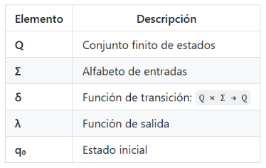
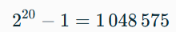
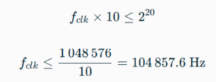
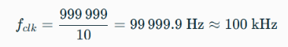

# LABORATORIO 04: SEMAFORO CRONOMETRADO PEATONAL Y VEHICULAR 

## Integrantes
* [Wilmer Fernando Puentes Gomez](https://github.com/wilmerfepuentesgo-alt)
* [Jhojan Manuel Castro Mendoza](https://github.com/casjho05)
* [Alberto Rodriguez Medina](https://github.com/22561132!)
  
## INFORME

Indice:

1. [Documentación]
2. [Simulaciones]
3. [Evidencias]
4. [Conclusiones]
5. [Referencias]

### 1. DOCUMENTACION:

#### OBJETIVO:
- Comprender el modelo de Máquina de Estado Finito (FSM) tipo Moore.
- Diseñar e implementar una FSM en Verilog con separación clara de bloques combinacionales y secuenciales.
- Sintetizar y programar el diseño en la tarjeta DE10.Lite (MAX 10).
- Verificar el comportamiento temporal del semáforo mediante simulación y prueba en hardware.

#### MARCO TEÓRICO:

##### Maquinas de estado finito (FSM):
Una Máquina de Estado Finito es un modelo matemático de cómputo secuencial que consta de:
 

Existen dos modelos principales:

Moore: las salidas dependen solo del estado actual. La salida es más estable (menos glitches).
Mealy: las salidas dependen del estado y de las entradas actuales. Puede requerir menos estados.
En este laboratorio se implementa el modelo Moore, ya que cada luz del semáforo corresponde directamente a un estado.

#### Implementación en Verilog: 
Estructura de Tres Bloques
La FSM en Verilog se implementa con tres bloques always separados para claridad y buenas prácticas de síntesis:

always @(posedge clk) → Registro de estado (bloque secuencial)
always @(*)           → Lógica de transición (bloque combinacional)
always @(*)           → Lógica de salida (bloque combinacional)

Esta separación evita latch inferidos y facilita la verificación.

### RECURSOS Y MATERIALES: 

- Tarjeta de desarrollo - FPGA DE10-Lite (Max10)
- Software Quartus
- Modulo semaforo
 

### SIMULACIONES IMPLEMENTACION EN VERILOG Y CÓDIGOS: 

A continuacion se mostraran los resultados de la sintetizacion en Verilog de las siguientes simulaciones: 
- Módulo principal FSM 
- Divisor de reloj (50 MHz → 1 Hz)
-  Testbench de simulación (Archivo Test Bench) 

#### CODIGO Y SINTESIS IMPLEMENTADO EN VERILOG: 

En esta imagen observamos el espectro de cada estado del semaforo en donde se evidencia el estado lógico (0 o 1) todo esto depende del Timer que se le haya colocado en el codigo verilog que se mostrara a continuación: 

##### CODIGO VERILOG: 
###### ARCHIVO.V: 
module semaforo (
    input wire clk,          // Reloj de la tarjeta
    input wire rst,          // Botón de reinicio
    input wire [1:0] sw,     // Switches (por si los usas luego)

    output reg RV,           // Rojo Vehicular
    output reg AV,           // Amarillo Vehicular
    output reg VV,           // Verde Vehicular
    output reg RP,           // Rojo Peatonal
    output reg VP,           // Verde Peatonal
    output reg alarma        // Alarma sonora
);

// ==========================================
// 1. DIVISOR DE FRECUENCIA
// ==========================================
reg [24:0] counter;
reg clk_1HZ;

always @(posedge clk or posedge rst) begin
    if (rst) begin
        counter <= 0;
        clk_1HZ <= 0;
    end else begin
        if (counter == 25000000 - 1) begin 
            counter <= 0;
            clk_1HZ <= ~clk_1HZ;
        end else begin
            counter <= counter + 1;
        end
    end
end

// ==========================================
// 2. DEFINICIÓN DE ESTADOS Y TEMPORIZADOR
// ==========================================
reg [1:0] state;
reg [1:0] next_state;
reg [3:0] timer;

parameter s_rojo              = 2'b00;
parameter s_amarillo_A_verde = 2'b01;
parameter s_verde             = 2'b10;
parameter s_amarillo_V_rojo  = 2'b11;

// ==========================================
// 3. BLOQUE DE CONTROL DE ESTADOS (SECUENCIAL)
// ==========================================
always @(posedge clk_1HZ or posedge rst) begin
    if (rst) begin
        state <= s_rojo;
        timer <= 0;
    end else begin
        state <= next_state;
        if (state != next_state) begin
            timer <= 0;        // Reinicia el tiempo al cambiar de color
        end else begin
            timer <= timer + 1; // Cuenta los segundos
        end
    end
end

// ==========================================
// 4. BLOQUE DE TRANSICIÓN DE ESTADOS (COMBINACIONAL)
// ==========================================
always @(*) begin
    case (state)
        s_rojo: begin
            if (timer >= 4) next_state = s_amarillo_A_verde;
            else            next_state = s_rojo;
        end

        s_amarillo_A_verde: begin
            if (timer >= 2) next_state = s_verde;
            else            next_state = s_amarillo_A_verde;
        end

        s_verde: begin
            if (timer >= 4) next_state = s_amarillo_V_rojo;
            else            next_state = s_verde;
        end

        s_amarillo_V_rojo: begin
            if (timer >= 2) next_state = s_rojo;
            else            next_state = s_amarillo_V_rojo;
        end

        default: next_state = s_rojo;
    endcase
end 

// ==========================================
// 5. BLOQUE DE SALIDAS (COMBINACIONAL)
// ==========================================
always @(*) begin 
    // Valores por defecto seguros
    RV = 0; AV = 0; VV = 0;
    RP = 1; VP = 0; alarma = 0;

    case (state)
        s_rojo: begin
            RV = 1; // Autos detienen
            RP = 0; 
            VP = 1; // Peatones cruzan
            alarma = 1; // Alarma activa para ciegos
        end

        s_amarillo_A_verde: begin
            AV = 1; // Autos advertencia
            RP = 1; // Peatones esperan
            VP = 0;
        end

        s_verde: begin
            VV = 1; // Autos avanzan
            RP = 1; // Peatones esperan
            VP = 0;
        end

        s_amarillo_V_rojo: begin
            AV = 1; // Autos advertencia
            RP = 1; // Peatones esperan
            VP = 0;
        end

        default: begin
            RV = 1;
            RP = 1;
        end
    endcase  
end 

endmodule

##### ARCHIVO.TB: 
`timescale 1ns / 1ps // Definimos la escala de tiempo de la simulación
module tb_semaforo();

    // 1. REGISTROS (Para simular las entradas del semáforo)
    reg clk;
    reg rst;
    reg [1:0] sw;

    // 2. CABLES (Para observar las respuestas y luces del semáforo)
    wire RV, AV, VV;
    wire RP, VP;
    wire alarma;

    // 3. INSTANCIACIÓN (Conectamos nuestro semáforo bajo prueba)
    semaforo uut (
        .clk(clk),
        .rst(rst),
        .sw(sw),
        .RV(RV),
        .AV(AV),
        .VV(VV),
        .RP(RP),
        .VP(VP),
        .alarma(alarma)
    );

    // 4. GENERACIÓN DEL RELOJ SIMULADO
    // Cambia de estado cada 10ns, simulando un reloj rápido
    always begin
        #10 clk = ~clk;
    end

    // 5. SECUENCIA DE PRUEBA (ESTÍMULOS)
    initial begin
    
        $dumpfile("semaforo_sim.vcd"); // Crea el archivo de ondas
        $dumpvars(0, tb_semaforo);     // Guarda todas las variables del módulo
        

        // Inicializamos los valores en el tiempo cero
        clk = 0;
        rst = 1; // Empezamos con el Reset presionado para limpiar el circuito
        sw = 2'b00;

        #40; // Esperamos 40ns con el circuito reiniciado
        rst = 0; // Soltamos el Reset para que el semáforo empiece a funcionar

        // Dejamos correr la simulación por suficiente tiempo 
        // para ver todo el ciclo: ROJO -> AMARILLO -> VERDE -> AMARILLO -> ROJO
        #2000000; 

        $finish; // Terminamos la simulación
    end

endmodule

### EVIDENCIAS: 
A continuación se muestra la maquina de estado generada a traves de la implementacion en el software Quartus 

#### VIDEO DE IMPLEMENTACION FISICA: 

A continuacion se encontrara el video explicativo de la implementacion en fisico del semaforo implementado.

[Ver video en YouTube](https://youtube.com/shorts/JBvt_-BwdwY?si=5hRoGTocbvOZq-Df)

### CONCLUSIONES: 
• Salidas totalmente estables: En una FSM Moore, las luces del semáforo dependen únicamente del estado actual y no de las entradas del sistema, lo que garantiza que las combinaciones de colores sean completamente estables y libres de transiciones transitorias no deseadas (glitches).

• Sincronización robusta: Debido a que el cambio de luces está estrictamente ligado al cambio de estado (el cual ocurre en el flanco de reloj), el semáforo es altamente inmune al ruido en los sensores externos (como botones peatonales), ya que cualquier cambio en la entrada esperará al siguiente ciclo para procesarse.

• Mayor facilidad de diseño visual: El modelado de la FSM Moore resulta más intuitivo para sistemas de tráfico, ya que cada estado del diagrama representa de forma directa una combinación de luces física (por ejemplo, Estado 1 = Luz Roja, Estado 2 = Luz Verde).

• Predecible frente a emergencias: Al no depender de las entradas para generar la salida, si se activa una señal de prioridad (como el paso de una ambulancia), el sistema primero cambiará de manera ordenada al estado de emergencia antes de modificar las luces, evitando cambios abruptos y peligrosos.

• Ligero incremento en el número de estados: Como limitación inherente, un semáforo Moore puede requerir más estados intermedios que uno de tipo Mealy para manejar ciertas condiciones temporales o de sensores, aunque esto se compensa con la seguridad y orden que ofrece en el control de tráfico.

### PREGUNTAS A RESPONDER: 

1. Se usa Moore porque las salidas del semáforo —rojo, amarillo y verde— dependen únicamente del estado actual (ROJO, AMARILLO, VERDE), no de una entrada externa. Así, cada luz permanece estable durante todo el ciclo de reloj asociado a su estado y no puede cambiar accidentalmente a mitad del período por una variación de entrada. 

2. Con 3 estados, la codificación binaria mínima requiere:
 

Por tanto, se necesitan 2 flip-flops para el registro de estado: por ejemplo, ROJO=00, AMARILLO=01, VERDE=10. Una FSM binaria utiliza exactamente el número mínimo de flip-flops necesario para identificar cada estado.

3. Estado de amarillo intermitente a 1 Hz
Se agregaría un cuarto estado, por ejemplo AMARILLO_INTERMITENTE, que alterna la lámpara amarilla entre encendida y apagada a 1 Hz. El diagrama pasaría de 3 a 4 estados:

En AMARILLO_INTERMITENTE, la salida amarilla se controlaría con un contador o con el bit menos significativo de un contador dividido a 1 Hz:

VERILOG: 
localparam ROJO = 2'd0,
           VERDE = 2'd1,
           AMARILLO = 2'd2,
           AMARILLO_INTERMITENTE = 2'd3;

always @(posedge clk or posedge rst) begin
    if (rst)
        estado <= ROJO;
    else
        estado <= siguiente_estado;
end

always @* begin
    case (estado)
        ROJO: begin
            luz_roja = 1'b1;
            luz_amarilla = 1'b0;
            luz_verde = 1'b0;
        end
        VERDE: begin
            luz_roja = 1'b0;
            luz_amarilla = 1'b0;
            luz_verde = 1'b1;
        end
        AMARILLO: begin
            luz_roja = 1'b0;
            luz_amarilla = 1'b1;
            luz_verde = 1'b0;
        end
        AMARILLO_INTERMITENTE: begin
            luz_roja = 1'b0;
            luz_verde = 1'b0;
            luz_amarilla = blink_1Hz; // alterna 0/1 cada 0.5 s
        end
        default: begin
            luz_roja = 1'b1;
            luz_amarilla = 1'b0;
            luz_verde = 1'b0;
        end
    endcase
end

Para obtener 1 Hz, el parpadeo debe cambiar cada 0.5 s: amarillo encendido 0.5 s, apagado 0.5 s. Si el reloj base fuera de 1 Hz, bastaría alternar con blink_1Hz <= ~blink_1Hz cada flanco; si fuera más rápido, se necesita un divisor de frecuencia o un contador de medio segundo.

Con 4 estados, la codificación binaria requeriría 2 flip-flops —porque 
2^2=4
2^2=4 — y one-hot requeriría 4 flip-flops.

4. Si se escribe la lógica de siguiente estado y el registro de estado dentro de un único always @(posedge clk), el principal problema es que las señales que deberían ser combinacionales, como siguiente_estado, quedarían actualizadas solo en el flanco de reloj. Esto puede impedir que la lógica reaccione correctamente a los cambios de entradas entre flancos y complica la separación entre lógica secuencial y combinacional.

Además, si dentro de ese bloque se usan asignaciones por bloqueo (=) para señales supuestamente combinacionales, la síntesis puede inferir lógica no deseada, prioridades incorrectas o comportamientos dependientes del orden de las asignaciones. La práctica recomendada es separar:

always @(posedge clk): actualiza el registro de estado y contadores con asignaciones no bloqueantes (<=).

always @* o always_comb: calcula siguiente_estado y las salidas con asignaciones de bloqueo (=).

En un bloque combinacional, toda salida debe recibir valor en todas las ramas; de lo contrario, la herramienta de síntesis puede inferir un latch no intencional.

Un ejemplo correcto sería:

// Registro de estado
always @(posedge clk or posedge rst) begin
    if (rst)
        estado <= ROJO;
    else
        estado <= siguiente_estado;
end

// Lógica de transición y salidas
always @* begin
    siguiente_estado = estado;
    case (estado)
        ROJO: if (fin_10s) siguiente_estado = VERDE;
        VERDE: if (fin_10s) siguiente_estado = AMARILLO;
        AMARILLO: if (fin_3s) siguiente_estado = ROJO;
        default: siguiente_estado = ROJO;
    endcase
end

5. Un registro de 20 bits puede representar valores desde 0 hasta:

Si el contador incrementa una vez por ciclo de reloj y debe medir 10 s sin desbordar, la frecuencia de reloj debe cumplir:

Por tanto, la frecuencia máxima compatible es aproximadamente 104.86 kHz. Si la consigna pide la frecuencia que aprovecha exactamente el rango de 20 bits durante 10 s, el valor es 104.86 kHz; con una frecuencia mayor, el contador llegaría a más de 
2^20 pulsos en 10 s y desbordaría.

Si en cambio el contador debe alcanzar un valor determinado en 10 s —por ejemplo, contar hasta 999,999— la frecuencia necesaria sería:

En ese caso, un reloj de 100 kHz produce 1,000,000 pulsos en 10 s, valor que sí cabe en 20 bits porque 
1000000 < 1048576 1000000<1048576. La redacción “frecuencia mínima” probablemente se refiere a la frecuencia necesaria para completar la cuenta de 10 s dentro del rango disponible; el límite real de no desbordamiento es:
𝑓 𝑐𝑙𝑘 ≤ 104.86kHz.
𝑓 clk ≤ 104.86 kHz.