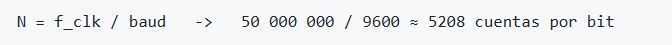

# LABORATORIO 07: PROYECTO FINAL PROTOCOLO COMUNICACION UART. 

## Integrantes
* [Wilmer Fernando Puentes Gomez](https://github.com/wilmerfepuentesgo-alt)
* [Jhojan Manuel Castro Mendoza](https://github.com/casjho05)
* [Alberto Rodriguez Medina](https://github.com/22561132!)
  
## INFORME:

1. [Documentación]
2. [Simulaciones]
3. [Evidencias]
4. [Conclusiones]
5. [Preguntas]

### DOCUMENTACION:

#### 1.1 OBJETIVOS: 

Al finalizar el proyecto, el estudiante será capaz de:

- Diseñar e implementar un módulo de comunicación serial asíncrona (UART) en Verilog.
 
- Integrar en una sola solución lógica combinacional y secuencial: transmisor, receptor, generador de baudios, conversión de datos y entrada/salida de usuario.

- Establecer comunicación en ambos sentidos entre la FPGA y un PC mediante una terminal serial (PuTTY).

- Verificar el comportamiento del sistema mediante simulación e implementación en la tarjeta DE10-Lite (MAX 10).

#### 1.2 DESCRIPCION DEL SISTEMA: 

El sistema establece un enlace serial entre la tarjeta y el PC. La correspondencia de recursos es directa: la DE10-Lite tiene 10 switches y 10 LEDs, es decir 10 bits, que cubren exactamente el rango 0 a 1023.

El funcionamiento comprende los dos sentidos de la comunicación, y ambos se evidencian en la simulación y en la demostración final:

Sentido FPGA → PC (transmisión). El usuario fija un número de 0 a 1023 en los switches SW9..SW0 y presiona un botón (KEY0). La FPGA transmite ese valor por UART y el número aparece impreso en la terminal PuTTY.

Sentido PC → FPGA (recepción). El usuario escribe un número de 0 a 1023 en PuTTY y lo confirma con Enter. La FPGA recibe el dato por UART y lo representa en binario sobre los 10 LEDs 

#### 2. MARCO TEÓRICO: 

##### 2.1 PROTOCOLO DE COMUNICACION UART ASINCRONA: 

La UART transmite los datos bit a bit por una sola línea y de forma asíncrona: no se envía una señal de reloj, sino que emisor y receptor acuerdan de antemano la misma velocidad (baud rate) y el mismo formato de trama. La línea en reposo se mantiene en nivel alto.

##### 2.2  LA TRAMA UART: 

- Start (0): un bit en bajo marca el inicio.
- Datos: 8 bits, el menos significativo primero.
- Stop (1): un bit en alto cierra la trama.
- Formato típico 8-N-1: 8 bits de datos, sin paridad, 1 bit de stop.

##### 2.3 VELOCIDAD (BAUD RATE) Y GENERACION DE SEÑAL: 

La duración de un bit es 
Tbit = 1/baud.
Un contador (divisor) sobre el reloj de 50 MHz marca cada bit:

##### 2.4 REPRESENTACION DEL NÚMERO: 8 BITS VS 10 BITS:

Un byte UART transporta 8 bits (0–255), pero el rango 0–1023 requiere 10 bits. Por eso el número viaja como texto (dígitos ASCII) y en cada extremo se realiza una conversión:

Transmisión: el valor de 10 bits de los switches se convierte a dígitos decimales ASCII (hasta "1023") y se envían uno a uno.
Recepción: se reciben los dígitos ASCII escritos en PuTTY y se acumulan (valor = valor*10 + dígito) hasta el Enter, obteniendo el valor de 10 bits para los LEDs.
Esta conversión binario↔decimal es parte central del proyecto.

##### 3.5 TRANSMISOR Y RECEPTOR: 

- Transmisor (TX): una FSM carga el byte y lo desplaza por la línea (start → 8 datos → stop). Es el bloque más sencillo.
- Receptor (RX): una FSM detecta el flanco de bajada del start, muestrea cada bit en su centro (sobremuestreo) y reconstruye el byte.       Valida el bit de stop (error de trama si no es 1).

#### 4. RECURSOS Y MATERIALES: 

- Tarjeta de desarrollo FPGA (MAX II).
- Software Quartus y terminal PuTTY en el PC.
- Adaptador USB-TTL (CP2102, CH340 o FT232) configurado a 3.3 V.
- Cables de conexión.

#### 5. PROCEDIMIENTO: 

##### Paso 1 — Diseño
En el informe:

Diagrama de bloques del sistema (TX, RX, generador de baudios, conversores, E/S).
Trama UART y formato elegido (baud, bits de datos, stop).
Diagramas de estado de las FSM de transmisión y recepción.
Plan de conversión binario↔decimal para los dos sentidos.

##### PASO 2 IMPLEMENTACION EN VERILOG: 

Cree el proyecto en Quartus con los archivos de la plantilla base y complete los espacios marcados con // TODO:

##### PASO 3 SIMULACION:

- Simule el transmisor: al pulsar el botón, verifique en la forma de onda la trama de cada dígito enviado.
- Simule el receptor: inyecte una trama y verifique que el valor reconstruido aparece en los LEDs.
- Capture las formas de onda de los dos sentidos para el informe.

##### PASO 4 IMPLEMENTACION FISICA:

- Asigne los pines: SW9..SW0, KEY0, LEDR9..LEDR0, GPIO_TX, GPIO_RX.
- Conecte el adaptador USB-TTL y abra PuTTY con la configuración acordada.
- Compruebe los dos sentidos:
- Switches + botón → el número se imprime en PuTTY.
- Número escrito en PuTTY → se muestra en binario en los LEDs.
- Suba el proyecto al repositorio con la documentación y las evidencias.

#### 6. PREGUNTAS DE ANALISIS: 

- ¿Por qué un solo byte UART no alcanza para representar los números 0–1023, y cómo lo resuelve su diseño?
- Calcule el número de cuentas del generador de baudios para 9600 baudios con el reloj de 50 MHz.
- ¿Por qué el receptor es más complejo que el transmisor?
- ¿Por qué se detecta el flanco del botón y no su nivel para transmitir?
- ¿Qué es un error de trama (framing error) y cómo lo detectaría el receptor?
- ¿Por qué es necesario sincronizar la línea RX antes de usarla en la FSM?
- ¿Qué diferencia habría entre enviar el número en binario crudo y enviarlo como texto ASCII?

RESPUESTAS: 

